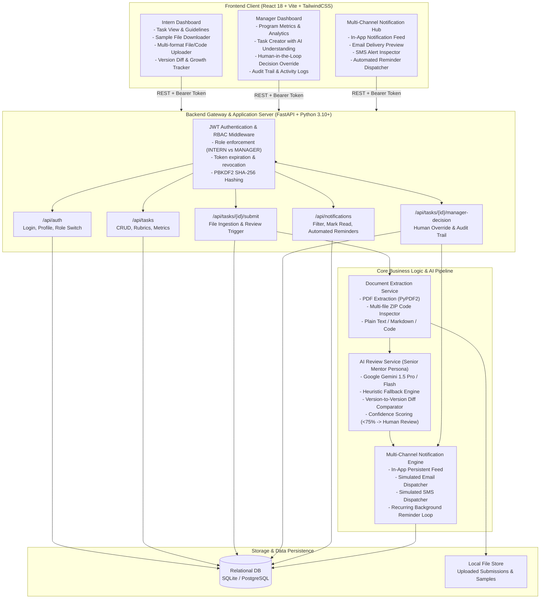
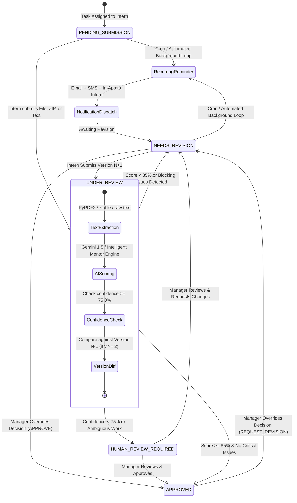
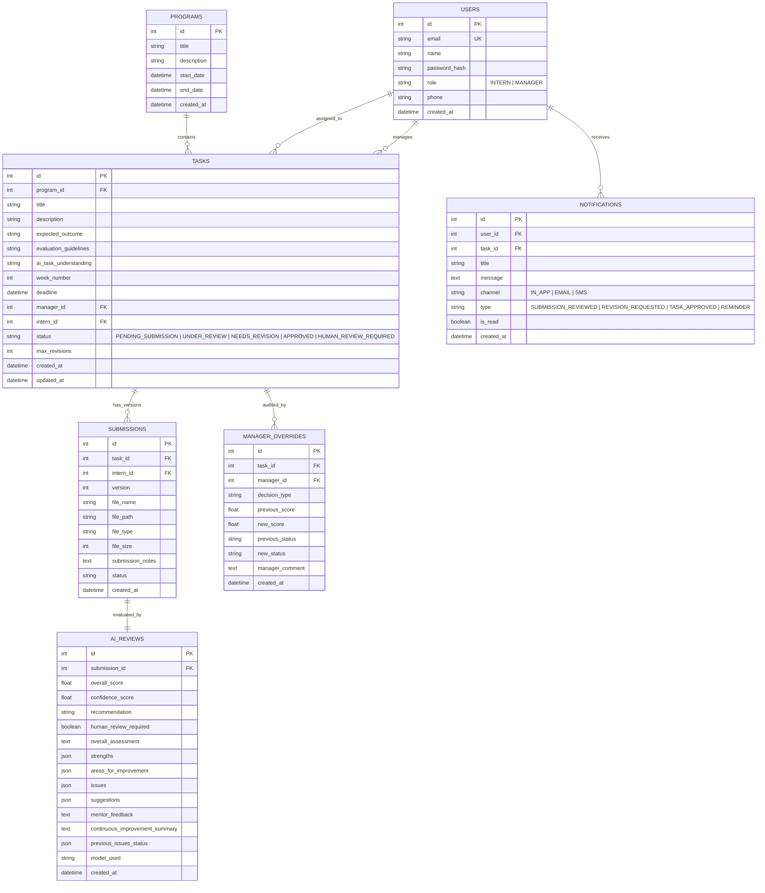

# MentorAI: Architecture & API Specification

Comprehensive architectural design, component topology, entity schema, and API catalog for the **Employee AI Task Review System (MentorAI)**.

---

## 1. System Architecture Diagram



---

## 2. Submission Lifecycle & State Machine



---

## 3. Role-Based Access Control (RBAC) Matrix

| Endpoint | Method | Public | INTERN | MANAGER | Description |
|---|---|:---:|:---:|:---:|---|
| `/api/auth/login` | POST | Yes | Yes | Yes | Authenticate and obtain JWT bearer token |
| `/api/auth/me` | GET | No | Yes | Yes | Retrieve authenticated user profile |
| `/api/auth/demo-switch/{role}` | POST | Yes | Yes | Yes | Developer/demo utility to switch active role |
| `/api/tasks` | GET | No | Yes | Yes | List program tasks with latest submission status |
| `/api/tasks/{task_id}` | GET | No | Yes | Yes | Fetch task details, evaluation rubric, and history |
| `/api/tasks` | POST | No | **403** | **200** | Create task with auto AI Understanding synthesis |
| `/api/tasks/{task_id}/submit` | POST | No | Yes | Yes | Submit task deliverable (PDF, ZIP, TXT, MD, Code) |
| `/api/tasks/{task_id}/manager-decision` | POST | No | **403** | **200** | Human-in-the-loop override with audit trail |
| `/api/metrics/manager` | GET | No | **403** | **200** | Managerial program health, bottlenecks & scores |
| `/api/notifications` | GET | No | Yes | Yes | Fetch user notifications (channel filtered) |
| `/api/notifications/{id}/read` | PUT | No | Yes | Yes | Mark single notification as read |
| `/api/notifications/read-all` | PUT | No | Yes | Yes | Bulk mark all notifications as read |
| `/api/tasks/reminders/trigger` | POST | No | Yes | Yes | Trigger automated recurring reminder check |
| `/api/sample-files/{filename}` | GET | Yes | Yes | Yes | Download verified testing sample files |
| `/api/health` | GET | Yes | Yes | Yes | System liveness, model status, and version |

---

## 4. Complete API Endpoint Catalog

### Authentication (`/api/auth`)

#### `POST /api/auth/login`
Authenticates a user with email and password, returning an access token and user metadata.
- **Request Body**:
  ```json
  {
    "email": "intern@demo.com",
    "password": "password123"
  }
  ```
- **Success Response (200 OK)**:
  ```json
  {
    "access_token": "eyJhbGciOiJIUzI1NiIsInR5cCI6IkpXVCJ9...",
    "token_type": "bearer",
    "user": {
      "id": 2,
      "name": "Alex Chen",
      "email": "intern@demo.com",
      "role": "INTERN",
      "phone": "+15550192835"
    }
  }
  ```
- **Error Responses**: `401 Unauthorized` for bad credentials.

#### `GET /api/auth/me`
Returns current session profile. Requires `Authorization: Bearer <token>`.

#### `POST /api/auth/demo-switch/{role}`
Allows instant zero-friction switching between `INTERN` and `MANAGER` roles during demos and testing.

---

### Tasks & Evaluation Rubrics (`/api/tasks`)

#### `GET /api/tasks`
Lists all tasks for the internship program along with current submission status, latest scores, and revision counts.

#### `GET /api/tasks/{task_id}`
Returns granular task data:
- Full problem description and expected deliverables.
- Evaluation rubric with explicit scoring guidelines.
- Synthesized `ai_task_understanding` summary.
- Chronological submission version history.
- Structured AI evaluation results (strengths, issues, recommendations).
- Manager decision override history with comments.

#### `POST /api/tasks` (Manager Restricted)
Creates a new task. Automatically synthesizes structured `ai_task_understanding` based on guidelines.
- **Headers**: `Authorization: Bearer <manager_token>`
- **Request Body**:
  ```json
  {
    "title": "Secure Payment Gateway Integration",
    "description": "Implement Stripe webhook handler with signature validation.",
    "expected_outcome": "Working webhook receiver in FastAPI.",
    "evaluation_guidelines": "- Webhook signature verification\n- Idempotency key handling\n- Unit test coverage",
    "deadline": "2026-11-20T18:00:00Z",
    "week_number": 3
  }
  ```
- **Success Response (200 OK)**: Task object with generated `ai_task_understanding`.

---

### Task Submissions & AI Mentor Evaluation (`/api/tasks/{task_id}/submit`)

#### `POST /api/tasks/{task_id}/submit`
Uploads and evaluates an intern deliverable.
- **Content-Type**: `multipart/form-data`
- **Form Fields**:
  - `file`: (Optional) PDF, ZIP, TXT, PY, JS, TS, JAVA, MD, or JSON file.
  - `submission_notes`: (Optional) Explanatory text, notes, or repo URL.
- **Workflow**:
  1. Inspects and validates file extension and size.
  2. Extracts text from PDF via PyPDF2 or analyzes multi-file code hierarchies in ZIP archives.
  3. Dispatches payload to `AIReviewService`.
  4. Computes score, detects issues, compiles mentor feedback, and compares against Version $N-1$.
  5. Updates task status (`APPROVED`, `NEEDS_REVISION`, or `HUMAN_REVIEW_REQUIRED`).
  6. Dispatches multi-channel notifications (In-App, Email, SMS).
- **Success Response (200 OK)**:
  ```json
  {
    "task_id": 1,
    "submission_id": 1,
    "version": 2,
    "status": "APPROVED",
    "ai_review": {
      "overall_score": 88.0,
      "confidence_score": 91.0,
      "recommendation": "APPROVED",
      "human_review_required": false,
      "strengths": [
        "CRUD operations are well-structured with clear RESTful URI conventions.",
        "Input validation has been implemented with clear request payload verification."
      ],
      "issues": [],
      "suggestions": [
        "Add automated integration tests covering edge cases."
      ],
      "mentor_feedback": "Excellent improvement on this revision! You addressed the input validation gaps...",
      "continuous_improvement_summary": "Resolved 2 prior issues. Overall score improved by +16 points.",
      "previous_issues_status": [
        {"issue": "Missing input validation", "status": "RESOLVED", "note": "Resolved in v2"}
      ]
    }
  }
  ```

---

### Manager Decision Override & Audit Trail (`/api/tasks/{task_id}/manager-decision`)

#### `POST /api/tasks/{task_id}/manager-decision` (Manager Restricted)
Enables human mentors to supervise and override AI recommendations.
- **Headers**: `Authorization: Bearer <manager_token>`
- **Request Body**:
  ```json
  {
    "decision": "OVERRIDE_SCORE",
    "override_score": 95.0,
    "manager_comment": "Intern went beyond expectations with custom security filters."
  }
  ```
- **Allowed Decisions**: `APPROVE`, `REQUEST_REVISION`, `OVERRIDE_SCORE`.
- **Audit Trail**: Every override records the previous score, new score, previous status, new status, manager ID, timestamp, and human rationale.

---

### Multi-Channel Notifications & Automated Reminders

#### `GET /api/notifications`
Fetches user notifications. Supports query filtering: `?channel=IN_APP`, `?channel=EMAIL`, `?channel=SMS`.

#### `PUT /api/notifications/{id}/read`
Marks an individual notification as read.

#### `PUT /api/notifications/read-all`
Marks all notifications for the authenticated user as read.

#### `POST /api/tasks/reminders/trigger`
Triggers an automated recurring reminder scan:
- Scans all tasks in `PENDING_SUBMISSION` or `NEEDS_REVISION`.
- Detects tasks that have not received an update within the configured cadence.
- Dispatches multi-channel reminders (Email, SMS, In-App).
- Returns count and dispatch audit details.

---

## 5. Relational Database Schema


