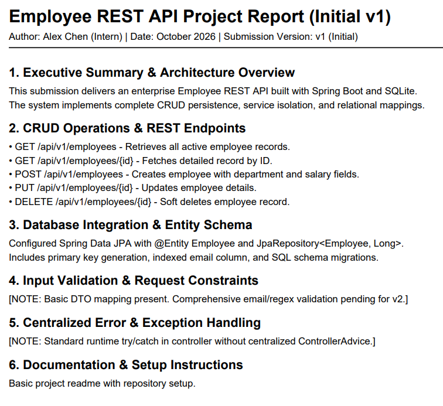
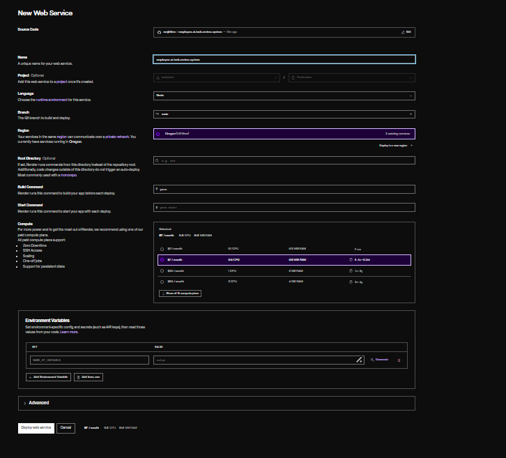
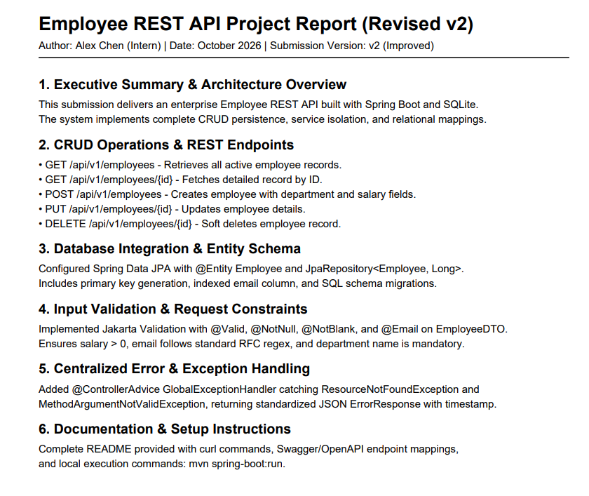
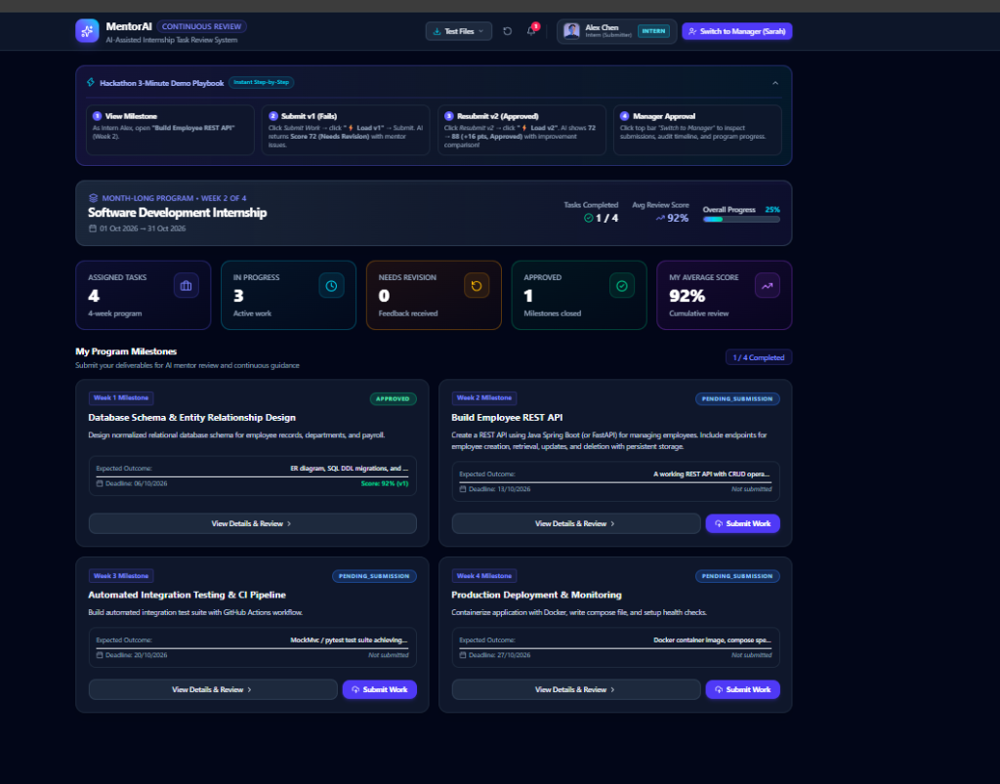
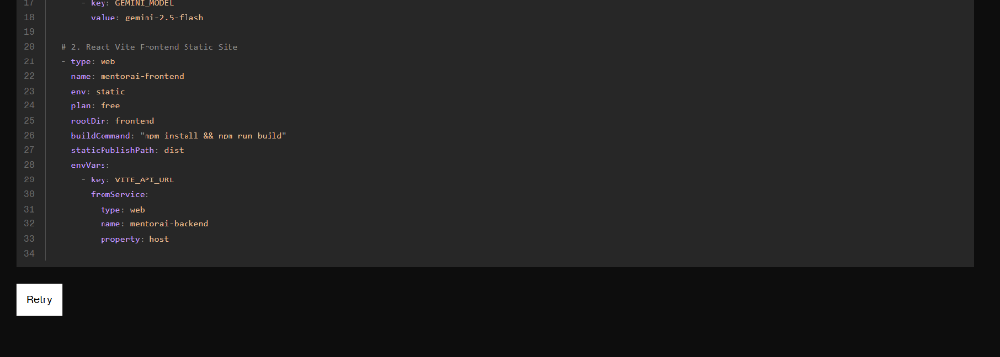

# MentorAI: System Screenshots & Visual Tour

Visual walkthrough of the **Employee AI Task Review System (MentorAI)** interface, workflows, and production deployment.

---

### 1. Intern Dashboard & Task Workflow
*File: `docs/screenshots/intern_dashboard.png`*

- **Week-by-Week Curriculum**: Track active and upcoming internship milestones.
- **Task Understanding & Evaluation Criteria**: Transparent display of objectives, expected deliverables, and rubrics.
- **Sample File Downloader**: Instant download of sample v1 (incomplete) and v2 (improved) PDFs/ZIPs for testing.
- **Multi-Format Submission**: Support for PDF documents, multi-file code ZIP archives, and direct notes.

---

### 2. Task Detail Modal & Continuous Improvement Feedback
*File: `docs/screenshots/task_detail_modal.png`*

- **Evidence-Based Scoring**: Objective score out of 100 with confidence indicator.
- **Continuous Improvement Diff**: Compares current submission with previous versions, showing score delta (e.g. `+16 pts`) and status of prior issues (`RESOLVED` vs `PENDING`).
- **Constructive Mentor Feedback**: Warm, actionable guidance structured like a human senior engineer.
- **Strengths, Issues, and Next Steps**: Concrete lists separating what was done well from areas needing revision.

---

### 3. Manager Dashboard & Program Supervision
*File: `docs/screenshots/manager_dashboard.png`*

- **Program Health Metrics**: Total interns, active tasks, program completion rate, and average review score.
- **Human-in-the-Loop Override**: Ability for managers to approve, request revisions, or adjust scores with mandatory rationale.
- **Audit History**: Complete logging of all managerial interventions with timestamps and comments.
- **Automated Recurring Reminders**: Controls to trigger multi-channel email/SMS reminders for pending deliverables.

---

### 4. Full System Architecture & Platform Overview
*File: `docs/screenshots/full_system_overview.png`*

- End-to-end view of the platform combining client dashboards, document parsing, Gemini AI evaluation, and notification channels.

---

### 5. Production Cloud Deployment
*File: `docs/screenshots/render_deployment.png`*

- **Backend API**: Hosted on Render (`https://employee-ai-task-review-system.onrender.com`).
- **Frontend App**: Hosted on Vercel (`https://employee-ai-task-review-system.vercel.app`).
- Live health checks, interactive OpenAPI docs (`/docs`), and auto-scaling production readiness.
